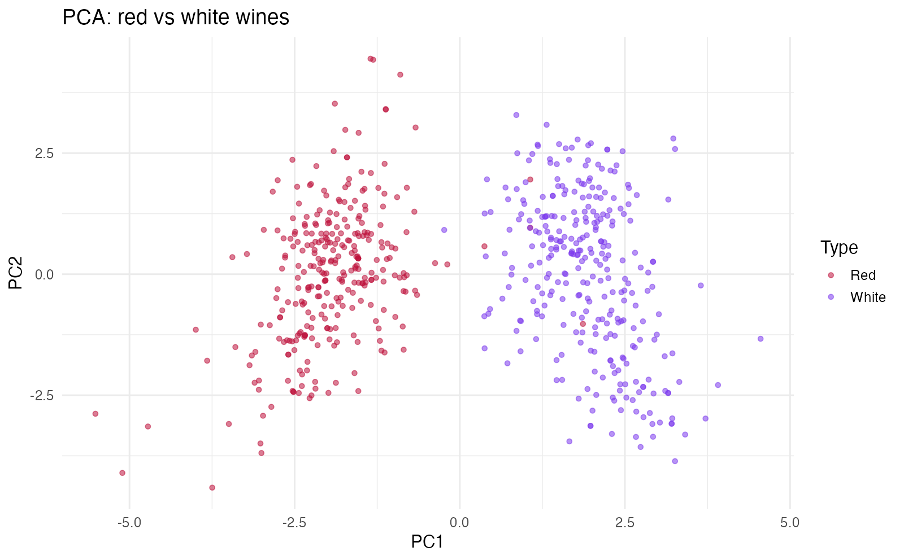
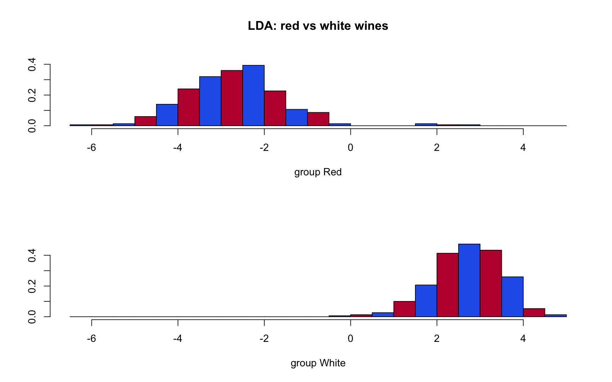
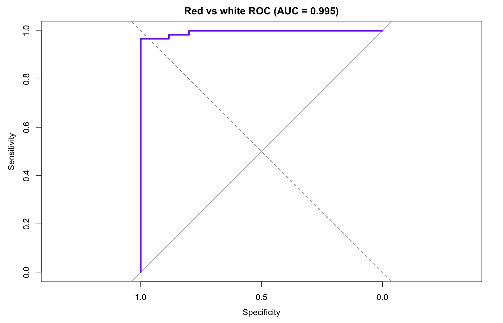
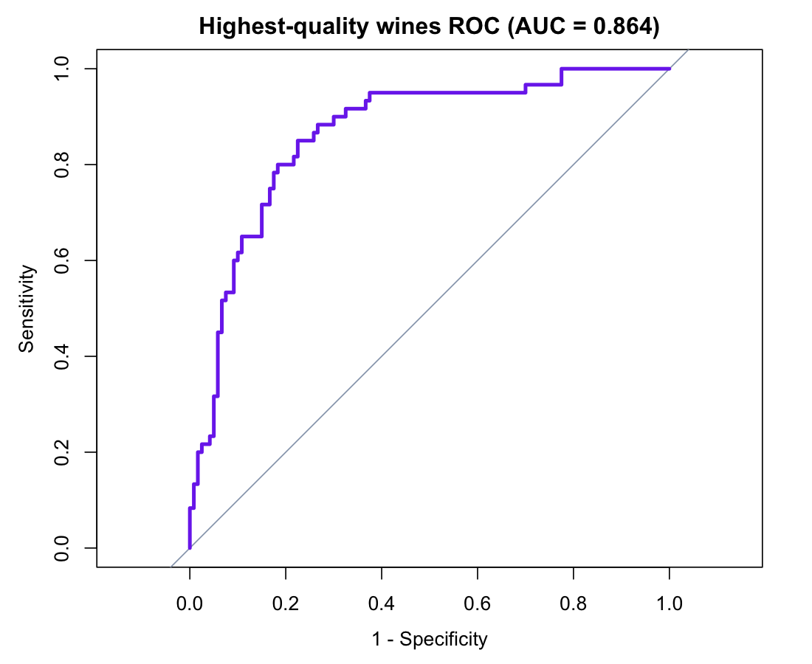
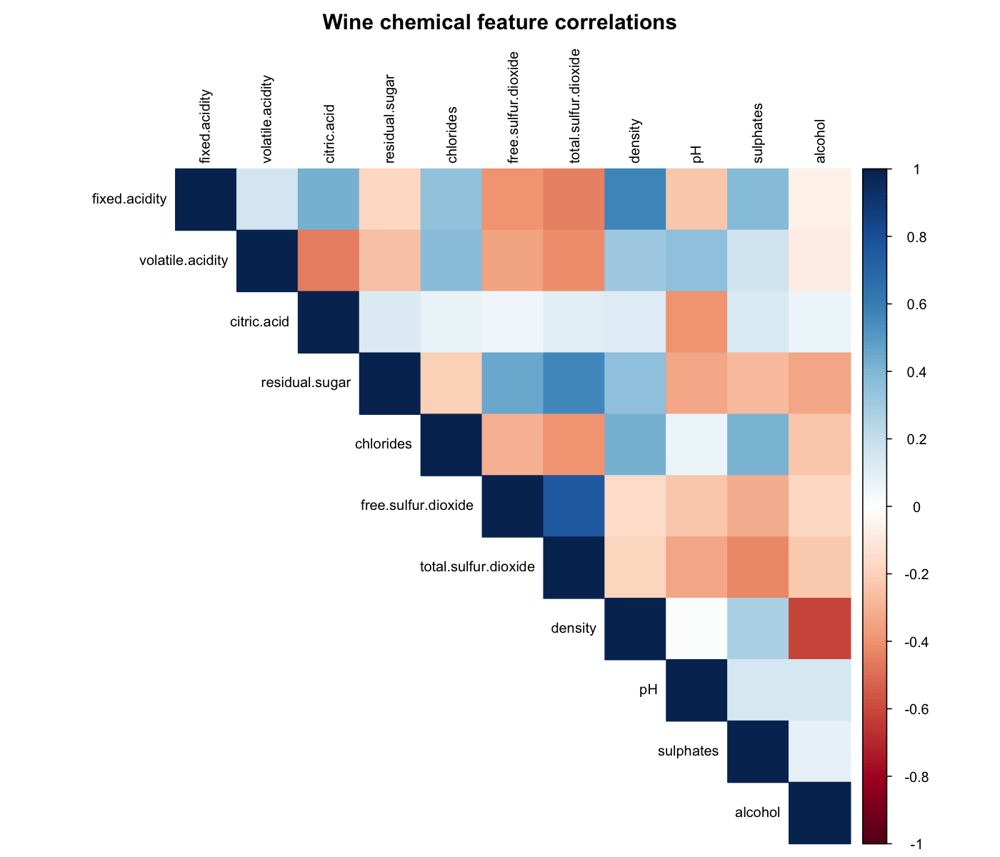
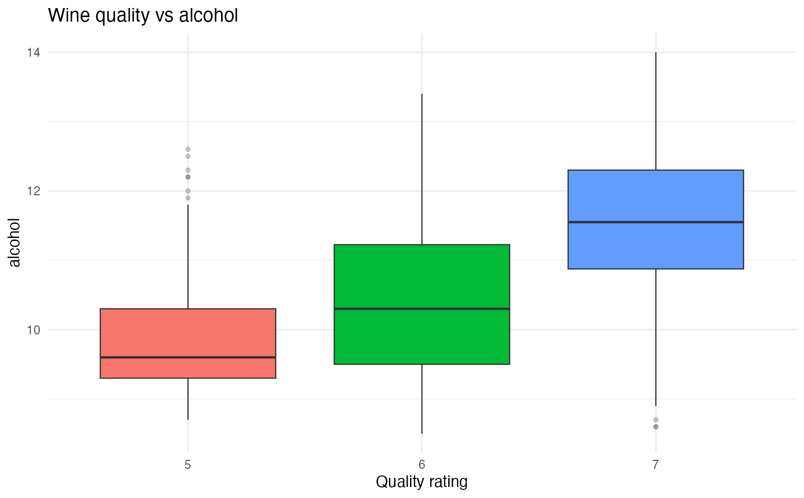

# Wine Quality Classification

## Overview
This project performs multivariate statistical analysis and classification on Portuguese wine data.

The goal was to:
1. Classify red vs white wines
2. Predict highest-quality wines
3. Analyze multivariate differences across quality levels

## Methods Used
- Correlation analysis
- Principal Component Analysis (PCA)
- Logistic Regression
- Linear Discriminant Analysis (LDA)
- Hotelling’s T² Test
- MANOVA
- ROC Curve / AUC Evaluation
- Train/Test Split

## Tools
- R
- tidyverse
- caret
- MASS
- pROC
- factoextra

## Key Results
- Strong separation between red and white wines in PCA space
- Logistic regression achieved high AUC for red vs white classification
- MANOVA indicated significant multivariate differences across quality groups

## Screenshots

### PCA separation

Red vs white wines separate clearly in PCA space.

### LDA separation

Linear discriminant projection for red vs white classification.

### ROC curve

Red vs white classification ROC with held-out AUC.

### High-quality ROC

ROC for classifying highest-quality wines vs the rest (AUC 0.864).

### Feature correlations

Upper-triangle correlation matrix of wine chemical properties.

### Quality vs alcohol

Alcohol level distributions across wine quality ratings.

## Author
Roy Ho  
UC Davis — Statistical Data Science
